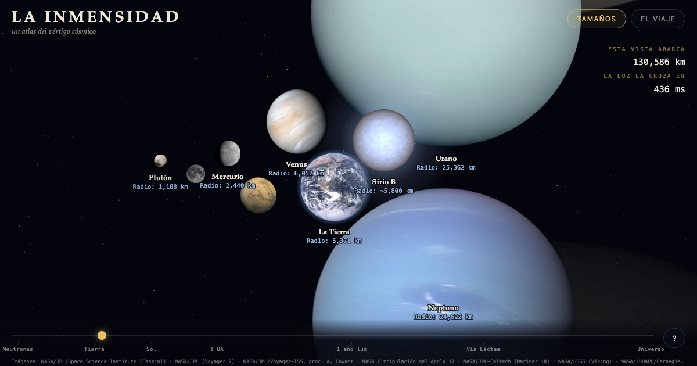

# La Inmensidad

**[Español](#español) · [English](#english)**

---

## Español

> *Dos maneras de perderse: comparar los tamaños de los astros, o viajar por las distancias que los separan.*

**La Inmensidad** es un atlas interactivo de escalas cósmicas: de una estrella de neutrones de 24 km al universo observable, de la línea de Kármán al fondo de microondas. Un solo archivo HTML con JavaScript a mano, sin dependencias ni servidor.

### ▶ Abrir

`https://alex-vazquez73.github.io/la-inmensidad/`

O sirve la carpeta con cualquier servidor estático (`python3 -m http.server`) y abre `index.html`. Abierto como archivo suelto desde la vista previa de Google Drive o de Archivos no funciona: esos visores no ejecutan JavaScript.

### Qué tiene

- **Tamaños:** 35 astros a escala, de una estrella de neutrones a la Gran Muralla Hércules–Corona Boreal y el universo observable.
- **El Viaje:** 24 hitos desde la Tierra hasta el borde observable, con distancias comóviles (Planck 2018) más allá de la galaxia.
- **Imágenes reales** de NASA, ESA, ESO y el Event Horizon Telescope. Lo que nadie ha fotografiado está reconstruido con datos reales y marcado como tal: las estrellas toman el color de su temperatura y los agujeros negros se escalan con su anillo de fotones (~2.6 veces el horizonte).
- **Incertidumbre visible:** el rango estimado del radio de las hipergigantes se dibuja, no se esconde.
- **Fichas** con foto, datos clave, explicación y un dato curioso para cada astro y cada hito.
- **Luz, tiempo real:** el viaje avanza exactamente a 299,792 km/s. La Luna llega en 1.3 s; Próxima Centauri, en 4.24 años.
- **Tu velocidad real:** cuánto te mueves sin moverte, respecto al fondo de microondas.

### Créditos y licencias

El código está bajo licencia MIT. **Las imágenes no**: cada una conserva su licencia (dominio público, CC BY 4.0, CC BY 2.0 o CC0). La lista completa está en [`img/CREDITOS.md`](img/CREDITOS.md) y en el panel «fuentes y créditos» de la app.

---

## English

> *Two ways to get lost: compare the sizes of celestial objects, or travel the distances between them.*

**La Inmensidad** ("The Immensity") is an interactive atlas of cosmic scales, in Spanish: from a 24 km neutron star to the observable universe, from the Kármán line to the cosmic microwave background. A single hand-written HTML file, no dependencies, no server.

**Open:** `https://alex-vazquez73.github.io/la-inmensidad/`

- **Sizes:** 35 objects to scale. **The Journey:** 24 milestones out to the edge of the observable universe, using comoving distances (Planck 2018) beyond the galaxy.
- **Real images** from NASA, ESA, ESO and the Event Horizon Telescope. What nobody has photographed is reconstructed from real data and labeled as such.
- **Light, real time** mode travels at exactly the speed of light.

The code is MIT-licensed. **The images are not**: each keeps its own license (public domain, CC BY 4.0, CC BY 2.0 or CC0); see [`img/CREDITOS.md`](img/CREDITOS.md).

---

Alejandro Vázquez · [Archivo](https://alex-vazquez73.github.io/) · 2026
